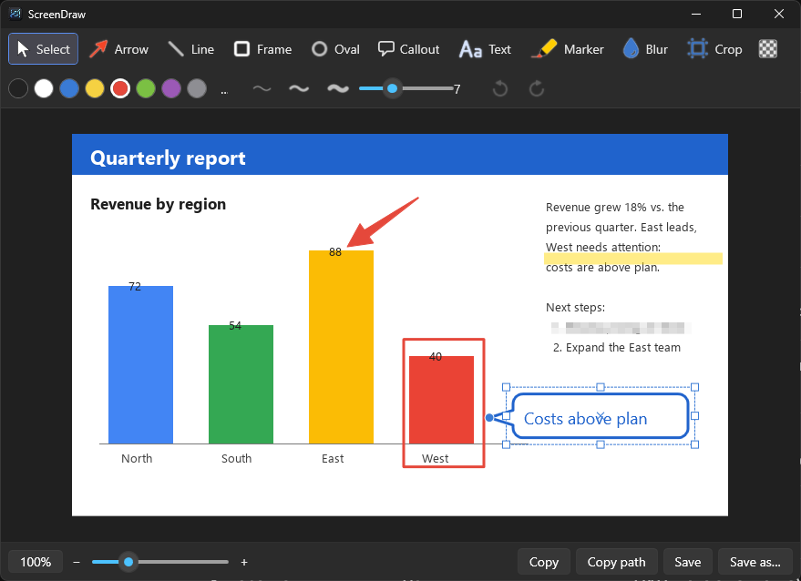

# ScreenDraw

[Русская версия](README.ru.md)

A small, fast screenshot tool for Windows: grab any area of the screen with a hotkey, annotate it in a dark editor, then copy it to the clipboard or save it to a folder of your choice. No cloud, no account — everything stays on your machine.



## Features

- **Area capture on a hotkey** (default ``Ctrl+Shift+` ``), works across several monitors and DPI settings. Lives in the system tray.
- **Annotations:** arrow (plain, tapered, dotted curved), line, frame, oval, callout with a pointer node, text (with optional light/dark background), highlighter, blur (pixelate), crop.
- **CorelDRAW-style transform frames:** click an object for scale handles, click it again to rotate around a pivot point you can drag anywhere. Arrows, lines and the highlighter use end nodes instead of a frame.
- **Everything is an object:** move, resize, rotate, restyle (colour, thickness) at any time; unlimited undo/redo.
- **Draw beyond the picture:** shapes can start outside the image — the canvas grows to fit.
- **Paste or drop other images** (`Ctrl+V`, drag a file in) and treat them as movable, scalable objects.
- **Remove background on save:** make a colour transparent (white by default) in PNG output and clipboard, with tolerance and an eyedropper; live checkerboard preview. Great for screenshots of documents.
- **Clipboard that keeps transparency:** PNG + 32-bit DIBV5 + a white-composited DIB, so applications that ignore alpha show white instead of black.
- **Zoom and pan:** `Ctrl`+wheel or the slider; middle mouse button pans (even when the picture fits).
- **Save and share:** always saves into your folder (even when you only copy), "Copy path" puts the file path on the clipboard, "Save as…" supports PNG and JPEG.
- **Dark UI, English and Russian** (follows Windows by default, switchable in Settings).

## Install

1. Install the [.NET 10 Desktop Runtime](https://dotnet.microsoft.com/download/dotnet/10.0) (if you don't have it yet).
2. Download `ScreenDraw-*-win-x64.zip` from the [Releases](https://github.com/Gimran/screendraw/releases) page and unpack `ScreenDraw.exe` anywhere.
3. Run it — an icon appears in the tray. Press ``Ctrl+Shift+` `` (the backtick key) to capture.

Tip: enable *Start with Windows* in Settings to have it always ready.

## Usage

1. Press the hotkey (or left-click the tray icon). The screen dims; drag a rectangle (right click / `Esc` cancels).
2. The editor opens with your capture. Pick a tool, draw, adjust.
3. **Copy** (clipboard + file), **Copy path**, **Save** or **Save as…**. By default the editor closes afterwards (configurable).

### Tools and shortcuts

| Key | Tool |
|---|---|
| `V` | Select / transform (hold `Ctrl` for a temporary select with any tool) |
| `A` `L` `R` `O` | Arrow, line, frame, oval |
| `K` | Callout (drag its node to set where it points) |
| `T` | Text |
| `M` `B` `C` | Marker, blur, crop (`Enter` applies, `Esc` cancels) |
| `Shift` | While drawing: 45° angles / squares. While scaling: from the centre. While rotating: 15° steps |
| `Del` | Delete the selected object |
| Arrow keys | Nudge the selection by one screen pixel |
| `Ctrl+Z` / `Ctrl+Y` | Undo / redo |
| `Ctrl+C` | Copy image (also saves the file) |
| `Ctrl+Shift+C` | Copy the file path |
| `Ctrl+S` / `Ctrl+Shift+S` | Save / Save as… |
| `Ctrl+V` | Paste an image from the clipboard |
| `Ctrl`+wheel, `Ctrl+0`, `Ctrl`+`+` / `-` | Zoom |
| Middle mouse drag | Pan |
| `Esc` | Close the editor |

### Removing a background

Turn on the checkerboard button in the toolbar. A third row appears: pick the colour to remove (click the swatch, use the eyedropper, or press *White*) and set the tolerance. The default 5 % is lossless for clean white backgrounds; raise it for noisy photos or JPEG-ish scans. Only PNG output and the clipboard are made transparent (JPEG cannot be).

## Settings

Open them from the tray icon's menu: save folder, hotkey (click the field and press the combination), language, start with Windows, copy-on-save and close-after options. Configuration is stored in `%APPDATA%\ScreenDraw\config.json`.

## Build from source

Requires the .NET 10 SDK on Windows.

```
dotnet publish -c Release -r win-x64 --self-contained false -p:PublishSingleFile=true -o dist
dist\ScreenDraw.exe
```

The code is plain WPF (C#), a few small files: `CanvasView.cs` (drawing and transforms), `Annotations.cs` (object types), `EditorWindow.cs` (UI), `Program.cs` (tray, hotkey, capture), `Loc.cs` (translations), `BackgroundRemover.cs` and `ClipboardImage.cs`.

## Notes

- Windows 10/11, x64.
- The hotkey is registered with the system (`RegisterHotKey`); if another program already owns it you get a notification and can choose another one in Settings.
