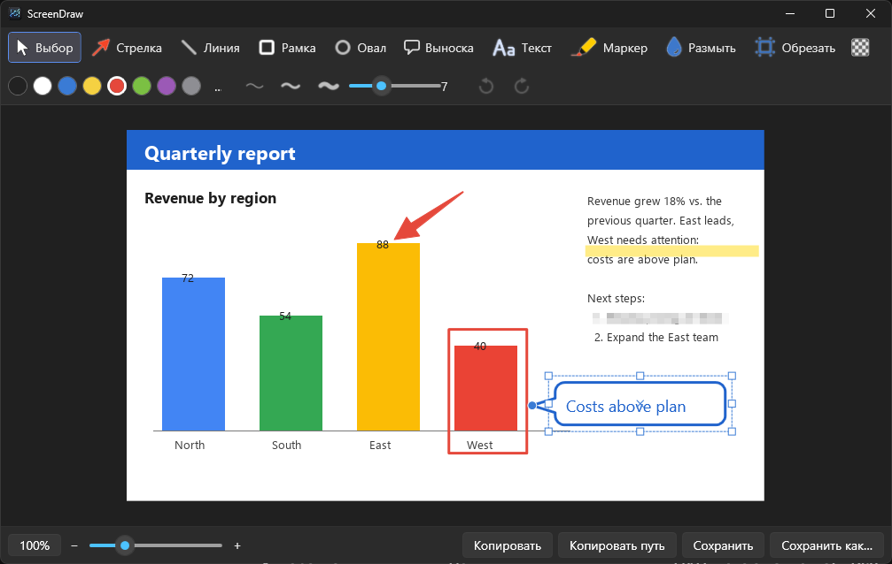

# ScreenDraw

[English version](README.md)

Небольшая быстрая утилита для скриншотов под Windows: выделяете область экрана по горячей клавише, размечаете её в тёмном редакторе и копируете в буфер обмена или сохраняете в выбранную папку. Без облака и аккаунтов — всё остаётся на вашем компьютере.



## Возможности

- **Снимок области по горячей клавише** (по умолчанию ``Ctrl+Shift+` ``), работает с несколькими мониторами и разным масштабом Windows. Живёт в трее.
- **Аннотации:** стрелка (обычная, сужающаяся, пунктирная изогнутая), линия, рамка, овал, выноска с узлом-указателем, текст (со светлым/тёмным фоном), маркер, размытие (пикселизация), обрезка.
- **Рамки преобразования как в CorelDRAW:** клик по объекту — маркеры масштаба, ещё клик — поворот вокруг точки, которую можно перетащить куда угодно. У стрелок, линий и маркера вместо рамки узлы на концах.
- **Всё — объекты:** двигать, масштабировать, поворачивать, менять цвет и толщину можно в любой момент; отмена/повтор без ограничений.
- **Рисование за пределами картинки:** фигуру можно начать вне изображения — холст расширится.
- **Вставка и перетаскивание других изображений** (`Ctrl+V`, файл в окно) как объектов, которые можно двигать и масштабировать.
- **Удаление фона при сохранении:** выбранный цвет (по умолчанию белый) становится прозрачным в PNG и в буфере обмена; допуск и пипетка, предпросмотр на шахматке. Удобно для скриншотов документов.
- **Буфер обмена с прозрачностью:** PNG + 32-битный DIBV5 + DIB, смешанный с белым, поэтому программы, игнорирующие прозрачность, показывают белый фон, а не чёрный.
- **Масштаб и панорама:** `Ctrl`+колесо или ползунок; средняя кнопка мыши двигает картинку (даже если она помещается).
- **Сохранение:** файл всегда попадает в вашу папку (даже при «Копировать»), «Копировать путь» кладёт путь к файлу в буфер, «Сохранить как…» умеет PNG и JPEG.
- **Тёмный интерфейс, русский и английский** (по умолчанию как в Windows, переключается в настройках).

## Установка

1. Установите [.NET 10 Desktop Runtime](https://dotnet.microsoft.com/download/dotnet/10.0), если его ещё нет.
2. Скачайте `ScreenDraw-*-win-x64.zip` на странице [Releases](https://github.com/Gimran/screendraw/releases) и распакуйте `ScreenDraw.exe` куда удобно.
3. Запустите — в трее появится значок. Нажмите ``Ctrl+Shift+` `` (клавиша с обратной кавычкой), чтобы сделать снимок.

Совет: включите «Запускать вместе с Windows» в настройках.

## Использование

1. Нажмите горячую клавишу (или левый клик по значку в трее). Экран затемнится — выделите прямоугольник мышью (правая кнопка / `Esc` — отмена).
2. Откроется редактор со снимком. Выберите инструмент, рисуйте, поправьте.
3. **Копировать** (буфер + файл), **Копировать путь**, **Сохранить** или **Сохранить как…**. По умолчанию после этого редактор закрывается (настраивается).

### Инструменты и клавиши

| Клавиша | Инструмент |
|---|---|
| `V` | Выбор / преобразование (с зажатым `Ctrl` — временный выбор при любом инструменте) |
| `A` `L` `R` `O` | Стрелка, линия, рамка, овал |
| `K` | Выноска (узел задаёт, куда она указывает) |
| `T` | Текст |
| `M` `B` `C` | Маркер, размытие, обрезка (`Enter` — применить, `Esc` — отмена) |
| `Shift` | При рисовании: углы 45° / квадрат. При масштабе: от центра. При повороте: шаг 15° |
| `Del` | Удалить выбранный объект |
| Стрелки клавиатуры | Сдвиг выбранного на один пиксель экрана |
| `Ctrl+Z` / `Ctrl+Y` | Отмена / повтор |
| `Ctrl+C` | Копировать изображение (файл тоже сохраняется) |
| `Ctrl+Shift+C` | Копировать путь к файлу |
| `Ctrl+S` / `Ctrl+Shift+S` | Сохранить / Сохранить как… |
| `Ctrl+V` | Вставить изображение из буфера |
| `Ctrl`+колесо, `Ctrl+0`, `Ctrl`+`+` / `-` | Масштаб |
| Перетаскивание средней кнопкой | Панорама |
| `Esc` | Закрыть редактор |

### Удаление фона

Включите кнопку с шахматкой на панели. Появится третья строка: выберите цвет для удаления (клик по образцу, пипетка или «Белый») и допуск. Допуск 5% по умолчанию без потерь работает на чистом белом фоне; для шумных фото и сканов с артефактами JPEG увеличьте его. Прозрачными становятся только PNG и буфер обмена (в JPEG прозрачности нет).

## Настройки

Открываются из меню значка в трее: папка сохранения, горячая клавиша (кликните в поле и нажмите сочетание), язык, запуск вместе с Windows, копирование в буфер при сохранении и закрытие редактора после действия. Конфигурация хранится в `%APPDATA%\ScreenDraw\config.json`.

## Сборка из исходников

Нужен .NET 10 SDK под Windows.

```
dotnet publish -c Release -r win-x64 --self-contained false -p:PublishSingleFile=true -o dist
dist\ScreenDraw.exe
```

Код — обычный WPF (C#), несколько небольших файлов: `CanvasView.cs` (рисование и преобразования), `Annotations.cs` (типы объектов), `EditorWindow.cs` (интерфейс), `Program.cs` (трей, хоткей, захват), `Loc.cs` (переводы), `BackgroundRemover.cs` и `ClipboardImage.cs`.

## Примечания

- Windows 10/11, x64.
- Горячая клавиша регистрируется в системе (`RegisterHotKey`); если её уже занимает другая программа, вы получите уведомление и сможете выбрать другую в настройках.
